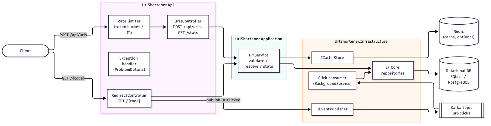
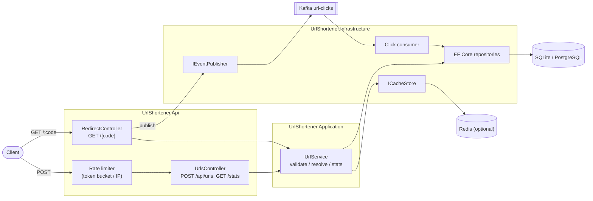
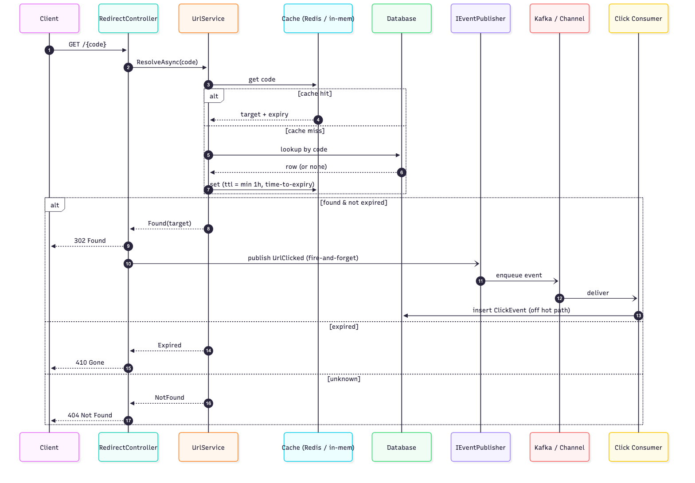
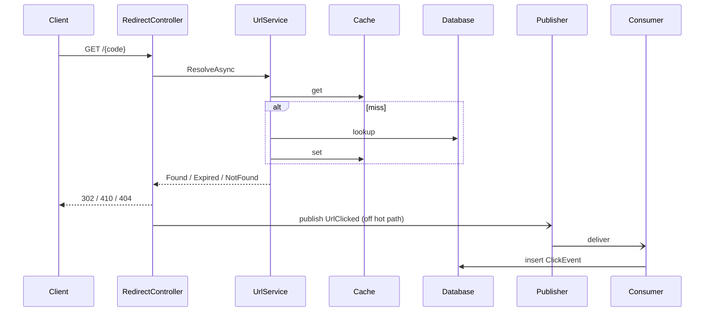

# Architecture Overview

> Deliverable: architecture overview (components, tools, execution approach, control flow, key decisions).

## 1. What it is
A URL shortener service: create short links (auto Base62 codes or custom aliases, optional expiry), redirect them fast, and record click analytics through an event pipeline — built to a production shape with resiliency, rate limiting, and clean layering.

## 2. Components (layered architecture, ADR-0001)

| Layer | Project | Responsibility |
|-------|---------|----------------|
| Domain | `UrlShortener.Domain` | Entities (`ShortUrl`, `ClickEvent`), domain events, interfaces. No external deps. |
| Application | `UrlShortener.Application` | `UrlService` — validation, code assignment, cache-aside resolve, stats. DTOs, exceptions. |
| Infrastructure | `UrlShortener.Infrastructure` | EF Core (SQLite/Postgres), Redis/in-memory cache, Kafka/in-memory events + consumer, Base62. |
| API | `UrlShortener.Api` | Controllers, DI composition, Swagger, ProblemDetails, rate limiting, DB init. |

Dependencies point inward (API → Application → Domain; Infrastructure implements Domain interfaces). This keeps the core testable without infrastructure.

## 3. Control flow

**Create** (`POST /api/urls`): validate URL (+ alias/expiry) → insert → assign Base62 code from the row id → write-through cache → `201`.
**Redirect** (`GET /{code}`): cache-aside resolve → `302`/`410`/`404` → publish `UrlClicked` fire-and-forget. Analytics never block the redirect.
**Stats** (`GET /api/urls/{code}/stats`): aggregate click rows → total + last-clicked + per-day buckets.

## 4. Key decisions (see `DECISIONS.md` / `adr/`)
- **.NET 10, layered, controllers** (ADR-0001)
- **Event-driven analytics**, Kafka behind `IEventPublisher` with in-memory fallback (ADR-0002)
- **EF Core + SQLite**, Redis cache, Postgres swap in compose (ADR-0003)
- **Sequential-id → Base62** codes; enumerability accepted + mitigation noted (ADR-0007)
- **Analytics scope + token-bucket rate limiting**, no raw IP (ADR-0008)

## 5. Resiliency highlights
- Cache failures degrade to the DB — redirect never fails on a Redis outage (verified).
- Click publishing is best-effort off the hot path — a Kafka outage doesn't break redirects.
- Health-gated container startup (`depends_on: service_healthy`).

## 6. Tooling
.NET 10 · EF Core · StackExchange.Redis · Confluent.Kafka · xUnit · Docker/Colima · docker-compose · GitHub Actions.
